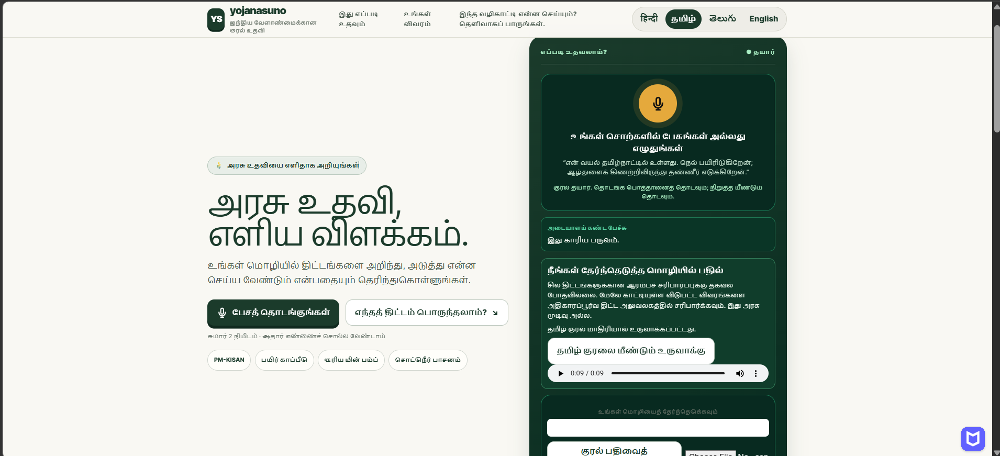
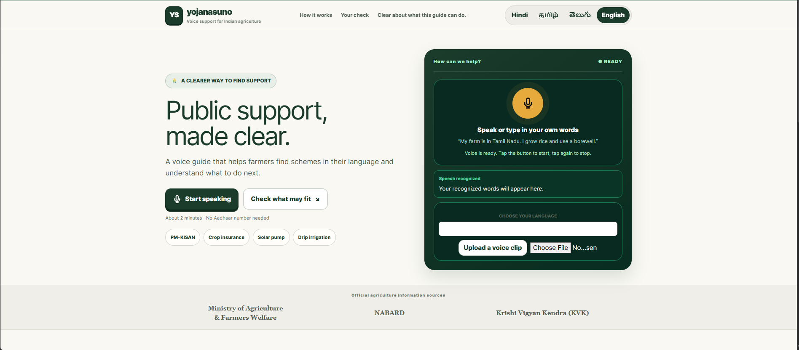
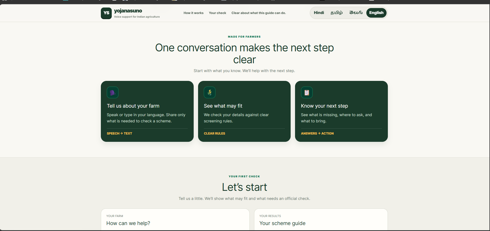
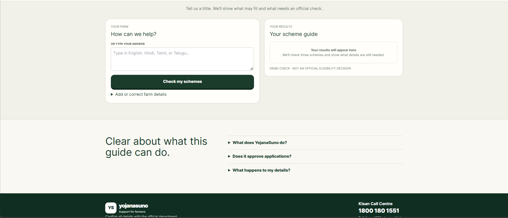
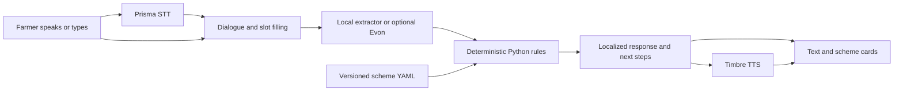

# YojanaSuno

A voice-first guide that helps farmers find which government schemes may fit them, in Hindi, Tamil, Telugu, or English.

**Problem:** Scheme rules are long and paperwork can be hard to navigate, so farmers may not know what applies or what to do next.

**Approach:** The farmer speaks or types; Gnani Prisma transcribes speech; a dialogue manager asks and confirms details; deterministic Python rules check versioned scheme data; Gnani Timbre can speak the result. Optional Gnani Evon is an extractor only and is not connected in the current demo.

> **Prototype and safety:** Active scheme rules are unverified drafts. Results are preliminary screening, not government decisions. In mock mode, speech recognition returns a canned phrase and does not transcribe the farmer. The current browser mic capture may fail with “Unable to decode audio data”; use the text box if it does. Never enter Aadhaar or bank numbers.

**Quick links:** [Watch the demo video](https://drive.google.com/file/d/1QIdUu2Do_JTcrqOWtBhfGeR10HRqBC6d/view?usp=sharing) · [One-page solution pitch](docs/solution_pitch.md) · [Demo walkthrough](docs/demo_script.md)

## Screenshots

| Tamil voice flow | English landing page |
|---|---|
|  |  |

| How it works and first check | Scheme form, FAQ, and footer |
|---|---|
|  |  |

## What the prototype does

- Supports Hindi, Tamil, Telugu, and English UI and dialogue prompts.
- Screens against three active demo schemes: PM-KISAN, PMFBY, and PM-KUSUM. Three additional proposals are kept in `backend/schemes/drafts/` for review.
- Asks follow-up questions, confirms details, and supports corrections instead of silently guessing.
- Uses an AI disclosure, redacts long digit sequences before extraction, and avoids collecting Aadhaar or bank numbers.
- Shows missing checks, source links, and next steps; falls back to the Kisan Call Centre at 1551 when voice service is unavailable.

## Architecture



| Component | Role in this demo |
|---|---|
| FastAPI | Local REST APIs and voice turn orchestration |
| Gnani Prisma | Speech-to-text adapter; real provider in live mode, canned mock in mock mode |
| Dialogue manager | Slot filling, clarification, confirmation, and correction |
| Local extractor / optional Evon | Extracts candidate fields; Evon is self-hosted and not enabled in the current configuration |
| Python rules + YAML | Deterministic scheme screening; the model never decides eligibility |
| Gnani Timbre | Text-to-speech adapter in live mode; silent audio mock otherwise |
| Vanilla JavaScript | Single-page, four-language demo UI |

## Try it locally

**Recommended: use the one-laptop launcher.** It creates the virtual environment, installs pinned demo dependencies if needed, runs preflight, starts the server on a free local port, and opens the page. The default is mock mode.

Prerequisites: Git and Python 3.11 or newer. On first run, the launcher needs internet access to install the pinned dependencies.

Windows:

```powershell
git clone https://github.com/sarveshraghavan/gnani_YojanaSuno.git
cd gnani_YojanaSuno
.\run_demo.bat
```

macOS / Linux:

```bash
git clone https://github.com/sarveshraghavan/gnani_YojanaSuno.git
cd gnani_YojanaSuno
./run_demo.sh
```

Use the text box for the mock demo. Stop with Ctrl+C, or run `stop_demo.bat` / `./stop_demo.sh` from another terminal.

### Live voice mode

Configure a rotated Gnani key locally in `backend/.env` (never commit it), then run `run_demo.bat live` on Windows or `./run_demo.sh live` on macOS/Linux. The launcher verifies live voice access before it starts. `USE_MOCK_LLM` remains enabled unless a separate Evon endpoint is configured; see [Evon setup](docs/evon.md).

## Safety and limitations

- All active scheme cards are marked unverified. Their rules are illustrative screens, not official eligibility criteria or approvals; state notices and application windows must be confirmed with official sources.
- The rules engine alone determines the screening result. Speech and language models can transcribe, extract candidate fields, and explain the result.
- The project does not submit applications or ask users to say identity or bank numbers. Sessions are temporary; long digit runs are redacted before extraction.
- Hindi, Tamil, and Telugu phrasing needs native-speaker review. Synthetic fixture scores are smoke checks, not field accuracy.

See [scheme verification notes](docs/scheme_verification.md) and the [source registry](docs/sources/sources.json).

## Tests and evaluation

From the repository root:

```bash
python eval/run_eval.py
```

Run the full offline test suite from `backend/` with `python -m pytest -q`. For a local service and browser preflight, see [the pre-demo checklist](docs/predemo_checklist.md). Language fixtures are in [language_cases.yaml](backend/tests/language_cases.yaml); field recordings must follow the [consented field-test protocol](docs/field_test_protocol.md). Evaluation uses synthetic fixtures unless explicitly identified as consented field recordings.

## Project structure

```text
backend/app/             FastAPI routes, dialogue, rules, providers
backend/schemes/         Three active, unverified scheme cards
backend/schemes/drafts/  Three proposed cards awaiting review
backend/tests/           API, rules, dialogue, and language fixtures
frontend/                Landing page, styles, JavaScript, screenshot
scripts/                 Demo launch, preflight, provider and review tools
eval/                    Synthetic evaluation cases and reports
docs/                    Pitch, demo guide, safety and review notes
```

## Roadmap

- Fix and verify browser microphone decoding across supported browsers.
- Connect the optional Evon extractor when a suitable self-hosted endpoint is available.
- Review scheme rules against current official notices and have Indic-language copy checked by native speakers.
- Collect consented field recordings before making any real-world accuracy claims.

## Troubleshooting

| Issue | What to try |
|---|---|
| Microphone is blocked | Allow microphone access for `localhost` in browser site settings, then reload. If decoding still fails, use typed input for now. |
| Port is busy | The launcher selects a free port from 8765–8794. If none is available, run `stop_demo.bat` / `./stop_demo.sh` and retry. |
| Live mode says the key is missing | Use mock mode, or configure the rotated key locally in `backend/.env`. Never paste it into source or chat. |
| Backend or provider check fails | Run `python scripts/preflight.py --quick --mode mock` for local checks; use live mode only when its provider check passes. |

## Maintainer and credits

Maintainer: [@sarveshraghavan](https://github.com/sarveshraghavan). Acknowledgement: [Gnani AI](https://www.gnani.ai/) for Prisma and Timbre APIs and model access.

**License:** No `LICENSE` file is present yet; reuse terms have not been specified.
